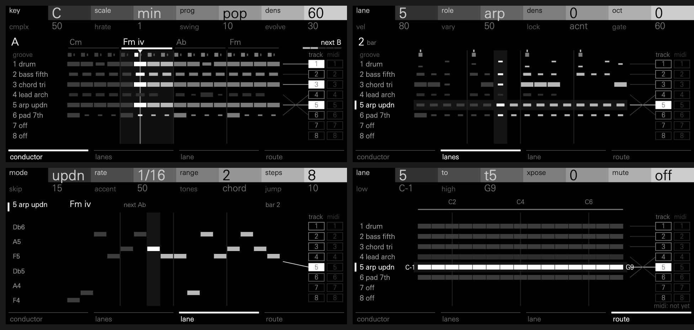

# OP-XY Conductor

A generative sequencer for the Teenage Engineering OP-XY, on the
[Open-XY SDK](https://github.com/etcetc000/open-xy). It sits on aux track 12
(CV) and plays eight lanes (drums, bass, chords, pads, arps and leads) live on
instrument tracks 1-8 while the sequencer runs.



- **One song, eight parts.** Every lane follows one chord progression, set by
  the key, scale and progression, and one groove of kicks, backbeats and
  accents, so the parts fit together.
- **It evolves.** The song changes a little each four-bar phrase, as far as
  **evolve** allows. Freeze it when you like what you hear. Notes are a pure
  function of the song, the controls and the bar, so it replays the same until
  something changes.
- **It plays, it doesn't record.** Notes go to each track's machine as the
  sequencer plays; nothing is written into the tracks' steps. Stopped, the song
  waits at its start.

**Status:** experimental. It runs on an OP-XY on OS 1.2.1 with a development
build of the SDK (see [What you need](#what-you-need)), not on stock firmware.

## Using it

On track 12, Shift + M1 opens the engine list: choose Conductor, then press
play. M1-M4 open its four pages, named along the bottom of the screen. Press
any encoder to switch between a page's two rows.

Every page reads left to right in the same rows: each lane's role and style,
what it plays, and a wire to where it plays, under two columns: track (1-8)
and midi (channels 1-8). A track's box lights while a lane plays it. The midi
column stays dim until the SDK can send notes over MIDI (see Limits).

| Page | Encoders | Screen |
| --- | --- | --- |
| M1 conductor | key, scale, prog, dens / cmplx, hrate, swing, evolve | The phrase: its chords, the groove, and every lane's beats, a mark a beat sized by its notes; the phrase's letter, and how much the next will change |
| M2 lanes | lane, role, dens, oct / vel, vary, lock, gate | The bar playing, step by step, for every lane; drums at the height of their lowest voice |
| M3 lane | the selected lane's role controls: a bass's style, an arp's mode, a chord's voicing… | The selected lane alone: its voices down the left (kick to low tom) or its notes (named in the key), its bar across, over lines at the chord's notes, and one wire to its track |
| M4 route | lane, track, xpose, mute / low, high | Each lane's range on a keyboard from C1 to C7, moved by its transpose, wired to its track |

M1's controls are saved, sequenced and lockable like any track's. Shift +
encoders 1-4 reroll, freeze, fill and vary: every lane on M1, the selected
lane on M2-M4; the header shows them on the row being edited. Freeze holds the
current phrase; turn it back to release it.

Lanes, roles, routes and the seed are saved with the project. The presets are
init (the defaults), Pop, Night and Jazz.

## What you need

Conductor uses SDK features that are not in `staging` yet; open-xy
[#345](https://github.com/etcetc000/open-xy/issues/345) tracks them:

- Track control ([#198](https://github.com/etcetc000/open-xy/pull/198)) and
  machines on track 12 ([#234](https://github.com/etcetc000/open-xy/pull/234)),
  so `machine.json` declares `"sdk": "1.8"`.
- Track-control notes, the machine's own encoders and sixteen display words
  ([`sdk/control-notes`](https://github.com/mmockett/open-xy/tree/sdk/control-notes)).

## Development

```sh
python ../open-xy/sdk.py test --machine .
python tools/artwork.py   # after changing a node's shape or slot
XY_FONT=/path/to/UniversNextPro-Light.ttf python tools/screens/screens.py --sdk ../open-xy   # docs/ screenshots
c++ -std=c++11 -O2 -I ../open-xy/sdk/include -I . tools/timing/timing.cpp -o /tmp/timing && /tmp/timing   # note timing on GUI ticks
python tools/timing/onsets.py recording.wav --bpm 120   # note timing on the device, from a recording
```

- `generator.h`: the generator, integer-only and within 32 bits.
- `specs.h`: the pages' controls and musical vocabulary.
- `control.cpp`: playback, encoders and saved data.
- `words.h`: what the control tells the display each tick, laid out by page.
- `display.cpp`: the pages.
- `tools/screens/`: renders the pages from the control and display code.
- `tools/timing/`: how late notes start on GUI ticks, on the host and from a
  recording of the device.

The engine is silent: Conductor plays other tracks' machines. The screenshots
need the OP-XY's screen font, which is never committed here.

## Limits

- Roles are set per lane: the OP-XY doesn't tell a machine which tracks hold
  drums.
- Notes start on the first GUI tick after their time, so each starts up to one
  tick late. On the host, at 60 ticks a second, that is 0-18 ms, 8 ms on
  average, never early, at any tempo; no tick starts more than 13 notes of the
  32 it may. A GUI stall of a second plays the notes it held back at once and
  drops past 32. The device's tick rate is not yet measured.
- M1-M4 are polled each GUI tick, so a press shorter than one tick can be
  missed.
- Lanes play instrument tracks 1-8 only. M4 shows MIDI channels 1-8 beside
  the tracks, but they can't be chosen yet: a machine's notes reach only
  tracks 1-8's own machines until the SDK can send them over MIDI.
- M3 shows the current bar, not the whole phrase.
